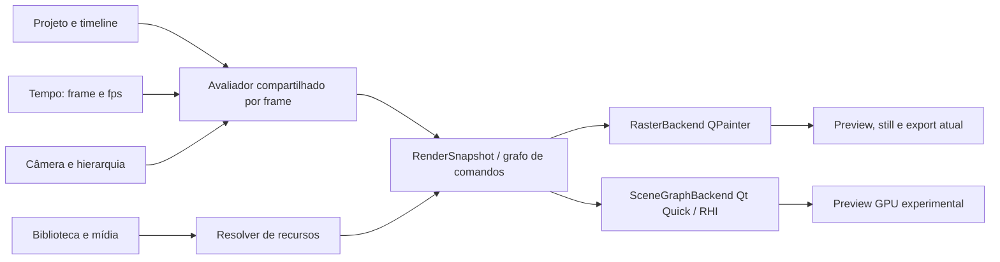

# ADR 0032 — fundação do motor gráfico 2.0

- Estado: aceita como direção arquitetural; Scene Graph segue experimental.
- Data: 26/10/2026

## Contexto

O documento do projeto já exigia medir `QPainter` e Qt Quick Scene Graph antes de decidir uma migração. O aplicativo usa `PreviewItem : QQuickPaintedItem`; seu `paint()` chama `CompositionPainter`. O render-worker também instancia `CompositionPainter` e produz `QImage` quadro a quadro antes de enviar RGBA ao FFmpeg. Isso mantém prévia, still e exportação no mesmo compositor, mas a prévia rasteriza a composição para uma imagem que o Qt Quick envia à textura. A avaliação de câmera e keyframes vem de `modules/core`; a composição resolve grupos, shots, direção de arte e mídia.

O Qt instalado é 6.8.3. Nesse release, trocar `QQuickPaintedItem` por um framebuffer acelerado não é uma opção portátil: o modo FBO desse item é ignorado em Qt 6.0–6.8. O Scene Graph tem suporte RHI a Direct3D 11, Vulkan, OpenGL e outros backends. A decisão precisa considerar qualidade, memória e exportação determinística, além do tempo por quadro. Referências: [QQuickPaintedItem 6.8](https://doc.qt.io/qt-6.8/qquickpainteditem.html), [Scene Graph 6.8](https://doc.qt.io/qt-6.8/qtquick-visualcanvas-scenegraph.html) e [QQuickRenderControl 6.8](https://doc.qt.io/qt-6.8/qquickrendercontrol.html).

## Diagnóstico atual

- `modules/core/src/project.cpp` avalia keyframes de objetos e câmera por índice de quadro; grupos e os IDs estáveis pertencem ao documento.
- `modules/composition/src/painter.cpp` calcula transformações hierárquicas e desenha fundos, shapes, texto/legendas, imagens, SVG, nativos e quadros de vídeo. Transições são compostas como camadas; o código é usado pela prévia e pelo worker.
- `modules/composition/src/native_painter*.cpp` implementa as ilustrações nativas como peças do mesmo passe QPainter. O catálogo não deve criar renderizadores paralelos por asset.
- `apps/desktop/preview_item.cpp` usa `QQuickPaintedItem`, transforma coordenadas de entrada e desenha a seleção como overlay da interface.
- `apps/render-worker/main.cpp` fixa o tempo no índice de quadro, compõe com `CompositionPainter`, envia RGBA ao FFmpeg e deixa áudio/mixagem no worker. A renderização não depende do relógio de parede.
- `modules/composition` publica `RenderSnapshot` por quadro. O QPainter e o protótipo GPU usam os mesmos estados resolvidos para câmera, grupos, keyframes, visibilidade, opacidade, direção de arte e shots.

## Medição comparativa

Executado em 26/10/2026 no Windows, Qt 6.8.3, AMD Radeon RX 7600 / driver 32.0.32015.7029 e AMD Ryzen 5 4600G. Cada perfil renderizou 60 quadros de um único projeto sintético com 120 formas arredondadas agrupadas, keyframes de grupo/objeto e movimento de câmera; há três repetições aquecidas por resolução. CPU é `CompositionPainter` para `QImage`; GPU é um protótipo `QQuickItem`/`QSGGeometryNode` em Direct3D 11, com `swapInterval=0` solicitado antes da criação dos recursos. Tempos incluem a avaliação/preparação das geometrias em cada backend, sem limitar o Scene Graph à taxa de atualização do monitor.

Esta tabela é a medição exploratória da etapa 1. O comparador de PSNR daquele protótipo não normalizava todos os formatos de canal das `QImage`; portanto, os valores de PSNR abaixo são apenas históricos e foram substituídos pelas métricas normalizadas de cor/forma/borda documentadas na etapa 3.

| Canvas | QPainter CPU ms/quadro | Scene Graph ms/quadro | PSNR CPU × protótipo | RSS do processo CPU → Scene Graph |
| --- | ---: | ---: | ---: | ---: |
| 1280×720 | 25,71 | 7,19 | 24,09 dB | 25,9 → 60,8 MiB |
| 1920×1080 | 36,30 | 6,27 | 24,13 dB | 30,3 → 73,9 MiB |
| 1080×1920 | 36,60 | 5,99 | 24,13 dB | 30,3 → 74,0 MiB |

O tempo por quadro do Scene Graph foi 72% menor em 720p, 83% menor em Full HD e 84% menor em retrato neste conjunto limitado. O RSS do processo ficou 2,3–2,4× maior no Scene Graph; esse número inclui a imagem CPU de referência ainda residente e não mede a VRAM dedicada do driver. A estimativa separada soma apenas geometria vetorial e um framebuffer RGBA, não é uma medição da memória total da GPU. A captura do protótipo tem diferença visual perceptível: 24 dB serve somente como guarda de regressão grosseira deste experimento e não atinge a consistência observada no pipeline atual (44,09 dB no smoke de preview/export). O benchmark não cobre texto, fontes, imagens, SVG, nativos, vídeo, efeitos, transições nem a exportação fora da tela; não prevê o desempenho de um motor completo. Os três tempos CPU tiveram dispersão considerável entre repetições; os valores da tabela são medianas, e o relatório conserva cada tentativa.

Os arquivos completos, PNGs e métricas estão em `artifacts/renderer-benchmark-20261026-032146512/` (fora do Git). O procedimento reproduzível é `scripts/benchmark-renderers.ps1 -Frames 60 -Nodes 120 -Repeats 3`.

## Decisão

1. Manter o projeto existente como fonte canônica. Tempo é sempre `{frame, fps}`; não usar timers de animação da interface como fonte para o render final.
2. Evoluir para um avaliador compartilhado que gera um `RenderSnapshot` imutável por quadro: transformações hierárquicas, opacidade/visibilidade, câmera, shot, direção de arte, ordem, bounds e referências a recursos resolvidos.
3. Definir um contrato de comandos/grupos de renderização derivado desse snapshot. Formas vetoriais, assets nativos e premium, tipografia, efeitos, profundidade 2.5D e mídia real são operações do mesmo grafo e compartilham tempo, coordenadas, câmera e transformações.
4. Ter adaptadores de backend, não motores por categoria: `RasterBackend` mantém QPainter e garante exportação/compatibilidade; `SceneGraphBackend` traduz o mesmo snapshot para nós/materials RHI na prévia; uma futura exportação GPU só é aceita quando sua saída fora de tela passar os mesmos testes determinísticos e de paridade.
5. Centralizar tipografia/fontes, geometria vetorial, texturas e decode de mídia em serviços/cache com chaves por revisão e orçamentos explícitos. Nativos e premium descrevem parâmetros/peças reutilizáveis; não implementam loops de composição isolados.
6. Manter seleção, alças e overlays de inspeção somente na UI. Eles não entram no snapshot exportado.
7. Não alterar schemas JSON, receitas, sincronização de voz ou projetos existentes nesta etapa. Nenhum asset premium é incluído por este protótipo.

## Primeira melhoria entregue

`RenderSnapshot` agora é construído para um quadro e possui cópias próprias do tempo/FPS/canvas, câmera resolvida, shots/transição, nós em ordem de camada, hierarquia, bounds, keyframes avaliados, opacidade/visibilidade, direção de arte e referências de mídia. O `CompositionPainter` consome os estados resolvidos e conserva a sequência de operações QPainter para manter a rasterização existente. O snapshot não mantém ponteiros para o `Project` editável e expõe acesso constante ao estado publicado. A representação define o contrato para um consumidor Scene Graph futuro; nenhum backend GPU foi ligado ao editor.

As imagens de referência cobrem o projeto demo, um quadro misto com PNG/SVG/vídeo, nativos e palavras de legenda, e uma transição dissolve. O comparador normaliza os formatos de canal antes do cálculo: os três resultados tiveram PSNR de 99 dB. Testes também verificam hierarquia, opacidade herdada, limites, câmera, referências de mídia, shots e quadro de saída da transição. O catálogo tem 72 nativos. Não houve mudança de capacidade JSON: receitas v1/v2/v3, schemas e guia da IA permanecem iguais.

As rodadas acima são registros históricos da extração do snapshot. A inspeção posterior identificou que a comparação visual antiga dependia de formato de canal não normalizado e de cor de vértice não premultiplicada; por isso, aqueles ~24 dB não devem ser comparados diretamente com o protocolo da etapa 3. O protótipo segue isolado e não autoriza adoção no editor.

O protótipo em `apps/scenegraph-prototype/` consome `RenderSnapshot::primary()`; não reavalia câmera, keyframes, hierarquia, opacidade herdada ou shots. Ele converte os nós Shape em uma malha QSG compartilhada, mantendo `drawOrder`. O material usa cores RGBA premultiplicadas, blending explícito e uma franja alfa de um pixel para antialias. Uma suíte sintética exercita retângulo, retângulo arredondado, elipse, contorno retangular, polilinha e caminho convexo; gera PNGs de referência QPainter por classe e imagens de diferença amplificadas. O item tem clipping pelo limite do canvas.

Essas primitivas são contratos internos do renderizador; receitas JSON ainda não escolhem o tipo de forma e o catálogo nativo não mudou. O Scene Graph continua experimental e não está conectado ao editor nem à exportação. `QSGVertexColorMaterial` não produziu geometria útil no backend software do Qt 6.8; o relatório marca esse backend como incompatível. Na entrega da etapa 3, texto/tipografia, assets nativos, imagens e SVG ainda estavam fora do protótipo; a etapa 4 registra a composição posterior desses conteúdos via texturas rasterizadas em CPU. Vídeo e composição de shots/transições continuam fora do protótipo.

O benchmark executável separa tempo total QPainter, construção do snapshot, preparação da malha, submissão/espera do `frameSwapped` e captura da janela. Mede RAM residente do processo e bytes reais da malha do último quadro; a VRAM dedicada não é medida. `frameSwapped` não é uma medição isolada de execução GPU. `scripts/benchmark-renderers.ps1` padrão cobre 20, 120 e 200 elementos, grupos aninhados, câmera animada, opacidade e objetos parcialmente fora do canvas, com três repetições por resolução; os resultados e diferenças ficam em `artifacts/renderer-benchmark-*`.

## Etapa 3 — primitivas vetoriais no Scene Graph

O Scene Graph agora consome somente `RenderSnapshot::primary()`: não reavalia keyframes, hierarquia, câmera, opacidade herdada, visibilidade, ordenação ou estado de shot. O snapshot fornece as transformações resolvidas; seus Shapes são traduzidos em malha de triângulos QSG. A prévia principal e a exportação continuam no `CompositionPainter`/QPainter.

O protótipo oferece retângulos, retângulos arredondados, elipses, contornos retangulares, linhas e caminhos convexos preenchidos ou traçados. O passe aplica transformação de grupo e câmera, opacidade, ordem do snapshot, clipping ao item e franja alfa de um pixel. A cor dos vértices é premultiplicada antes do blending. Os lotes são divididos antes de 60.000 vértices: a primeira matriz completa revelou que o caminho D3D11 do Qt descartava triângulos ao ultrapassar seu limite de índices de 16 bits numa única geometria (200 formas). A divisão em lotes preserva a ordem de desenho e resolveu a perda.

O comparador normaliza as imagens para ARGB32. PSNR fica como indicador geral e diagnóstico; os bloqueios de regressão também medem IoU de primeiro plano, F1 de bordas com tolerância de um pixel e MAE de cor. Para cenas preenchidas, o critério é IoU ≥ 0,94, edge F1 ≥ 0,95 e MAE ≤ 3. Para contornos e linhas de 3 px, IoU ≥ 0,74 é permitido devido à cobertura subpixel distinta entre rasterizadores; o critério continua exigindo edge F1 ≥ 0,95 e MAE ≤ 3. Os limites vêm acompanhados por PNGs dourados de QPainter e imagens de diferença amplificadas; defeitos como geometria ausente, bordas deslocadas acima de 1 px ou erro médio de cor acima de 3 falham independentemente do PSNR.

Benchmark completo executado em 26/10/2026 no Windows, Qt 6.8.3, Direct3D11. Cada cenário renderizou 60 quadros em três execuções. A cena tem grupos aninhados, câmera e transformações animadas, opacidade e elementos parcialmente fora do canvas. Os tempos estão em ms/quadro, exceto captura (ms por imagem final); RAM é o working set do processo medido durante o cenário. A coluna de espera inclui submissão e `frameSwapped`, não representa tempo puro de GPU.

| Canvas | Formas | QPainter | Snapshot | Preparação Scene Graph | Submissão/espera | Captura | RAM CPU | RAM processo Scene Graph | Geometria |
| --- | ---: | ---: | ---: | ---: | ---: | ---: | ---: | ---: | ---: |
| 1280×720 | 20 | 4,79 | 0,14 | 0,38 | 5,50 | 3,40 | 25,3 MiB | 63,1 MiB | 110 KiB |
| 1280×720 | 120 | 7,04 | 0,56 | 1,75 | 5,74 | 3,96 | 26,0 MiB | 74,0 MiB | 660 KiB |
| 1280×720 | 200 | 8,83 | 0,90 | 2,76 | 6,00 | 3,72 | 26,3 MiB | 73,2 MiB | 1.097 KiB |
| 1920×1080 | 20 | 9,11 | 0,14 | 0,39 | 6,09 | 6,33 | 29,7 MiB | 76,2 MiB | 110 KiB |
| 1920×1080 | 120 | 13,02 | 0,56 | 1,74 | 6,07 | 6,62 | 30,4 MiB | 87,1 MiB | 660 KiB |
| 1920×1080 | 200 | 13,53 | 0,95 | 2,75 | 5,82 | 6,66 | 30,8 MiB | 86,1 MiB | 1.097 KiB |
| 1080×1920 | 20 | 9,30 | 0,15 | 0,39 | 6,03 | 6,50 | 29,7 MiB | 76,4 MiB | 110 KiB |
| 1080×1920 | 120 | 13,84 | 0,59 | 1,84 | 5,90 | 6,60 | 30,4 MiB | 87,4 MiB | 660 KiB |
| 1080×1920 | 200 | 15,55 | 0,95 | 2,81 | 6,09 | 6,50 | 30,8 MiB | 86,5 MiB | 1.097 KiB |

A matriz não indica que o Scene Graph seja universalmente mais rápido: a preparação somada à submissão/espera consome cerca de 5,9–6,1 ms/quadro neste protótipo, e a captura acrescenta 3,4–6,7 ms por imagem. A RAM residente do processo Scene Graph fica 37–57 MiB acima da referência CPU; inclui Qt Quick e a imagem CPU mantida para comparação. VRAM dedicada não foi mensurada com confiabilidade. O desvio-padrão do QPainter variou de 0,23 a 2,42 ms/quadro; preparação do Scene Graph ficou entre 0,01 e 0,07 ms/quadro. O tempo de espera não isola execução GPU.

Na suíte mista de 120 formas (20 de cada classe) em 1280×720: PSNR 27,85 dB, IoU 0,948, edge F1 0,999 e MAE 1,96. As seis classes passaram as imagens de referência. Resumo por classe em 1280×720 / 20 formas:

| Primitiva | PSNR | IoU | Edge F1 | MAE |
| --- | ---: | ---: | ---: | ---: |
| Retângulo arredondado | 31,68 dB | 0,987 | 1,000 | 0,93 |
| Retângulo | 31,50 dB | 0,987 | 1,000 | 0,96 |
| Elipse | 32,74 dB | 0,987 | 1,000 | 0,74 |
| Contorno retangular | 30,13 dB | 0,775 | 1,000 | 1,17 |
| Linha | 32,13 dB | 0,769 | 0,998 | 0,75 |
| Caminho convexo | 32,45 dB | 0,985 | 1,000 | 0,76 |

IoU menor em linhas/contornos vem de diferenças na cobertura de traços finos de 3 px, não de perda do percurso; edge F1 e MAE confirmam proximidade das bordas e das cores. O relatório completo, PNGs dourados e diferenças está em `artifacts/renderer-benchmark-20261026-044152515/`; inclui dispersão por execução e comparação nos três canvases. O probe identificou que `QSGVertexColorMaterial` não entrega geometria útil ao backend software Qt 6.8, então esse backend está explicitamente não suportado pelo protótipo.

## Plano incremental de migração

| Corte | Trabalho | Critério de saída |
| --- | --- | --- |
| 0 — Instrumentação (feito parcialmente) | Benchmark reproduzível, teste de cache SVG, fotografia de referência e limites de memória. | Cenários de canvas e relatórios repetíveis; paridade atual preview/export protegida por smoke. |
| 1 — Avaliação compartilhada (implementado nesta etapa) | Extrair hierarquia, estado resolvido, câmera, ordem e metadados de shots para `RenderSnapshot`; QPainter consome estados resolvidos sem alterar pixels/schema. | Imagens de referência idênticas; a mesma `CompositionPainter` atende prévia, still e worker. |
| 2 — Primitivas vetoriais RHI (parcial, protótipo isolado) | QSG desenha retângulos, retângulos arredondados, elipses, contornos, linhas e caminhos convexos a partir do `RenderSnapshot`; aplica transformações, opacidade, ordem e clip do canvas. | O material não funciona no backend software; primitiva de curva Bézier, paths côncavos, clipping arbitrário e Scene Graph no editor continuam pendentes. Benchmarks não demonstram ganho geral nem medem VRAM. |
| 3 — Texto e assets nativos (composição experimental implementada; rasterização CPU) | Rasterizar camadas com `CompositionPainter` e compartilhá-las como texturas no Scene Graph; conversão dos nativos para geometria GPU ainda pendente. | Fontes/layout existentes, 72 nativos e compatibilidade visual; não implica vetorização GPU. |
| 4 — Imagens e SVG (composição experimental implementada; rasterização CPU) | Abrir imagem/SVG pelos caminhos existentes e compor textura versionada com LRU limitado; efeitos ainda pendentes. | Limites de memória, invalidação por mudança do recurso e métricas de cor/alpha. |
| 5 — 2.5D e vídeo | Planos com profundidade e câmera compartilhada; serviço de decode com timestamp/seek, frame cache e fallback CPU. | Preview, still e MP4 comparados em saltos, trim, speed, shots e áudio embutido. |
| 6 — Exportação RHI opcional | Avaliar `QQuickRenderControl`/target RHI para batches, sob controle de quadro e dispositivo. | Exatidão temporal, cor, fontes e estabilidade do worker validadas antes de adoção. |

Cada etapa mantém o rasterizador funcional. Só considerar troca ou backend selecionável após paridade visual definida por conteúdo, memória aceitável no hardware mínimo, tempo de export e fallback reproduzíveis. O benchmark inicial não aprova uma substituição.

## Verificação desta decisão

- `scripts/build.ps1 -Test`: 5/5 testes passaram, incluindo o novo teste de snapshot e regressão visual.
- `scripts/smoke.ps1`: passou; preview/export 44,09 dB em 1280×720.
- `scripts/smoke-workspace.ps1`: passou; projetos locais, catálogo completo e 72 recursos nativos.
- `scripts/smoke-production.ps1`: passou com Microsoft Daniel; inclui receita, áudio, shots, beats, retrato, vídeo e comparações preview/export. Maior caso: 2700 quadros, 18 shots e 20 Visual Beats; preview/export 42,50 dB.
- `scripts/benchmark-renderers.ps1`: matriz padrão completa (20/120/200 formas × três canvases × três repetições), três suítes mistas e seis referências de classe; passou em Direct3D11. Uma falha inicial em 200 formas levou à divisão da geometria em lotes; a execução completa passou depois da correção. O backend software foi reportado como não suportado. Resultados e imagens: `artifacts/renderer-benchmark-20261026-044152515/`.

## Etapa 4 — camadas híbridas de texto, mídia e biblioteca

O protótipo agora intercala primitivas vetoriais GPU e texturas no mesmo `QSGNode` tree, na ordem de `RenderSnapshot::primary()`. A avaliação de câmera, grupos, keyframes, opacidade, visibilidade e draw order continua compartilhada. Para texturas, o protótipo aplica a transformação resolvida e a câmera no nó de cena; a imagem é rasterizada em coordenadas locais por `CompositionPainter::rasterNodeLayer`, evitando reimplementar layout de texto e desenho dos nativos. A camada do fundo também reutiliza `CompositionPainter::rasterBackgroundLayer` quando selecionada.

Texto usa o mesmo painter e subsistema de fontes/layout do compositor de produção: fontes do sistema e fontes externas cadastradas, quebra, alinhamento, rotação/escala via transformação do nó, opacidade herdada e texto de legenda com palavra ativa por quadro. Fontes externas foram verificadas com Arial carregada de arquivo e a cena híbrida permaneceu dentro dos critérios visuais. Todos os 72 IDs de `nativeLibrary()` são exercitados pelo atlas; variantes dinâmicas incluem o frame na chave do cache. Isso comprova composição dos assets pelo Scene Graph, mas suas formas continuam desenhadas em CPU pelo painter nativo e transferidas como textura. Não é conversão dos 72 assets em geometria GPU. PNG transparente, JPEG e SVG foram lidos pelo mesmo `QImageReader`/cache SVG e transformados em texturas. WebP passou a ser suportado após preparar o plugin oficial Qt Image Formats da mesma instalação Qt 6.8.3; a leitura/escrita e transparência são verificadas em runtime. Não há decode de vídeo nesta etapa.

O cache de textura é LRU e limitado a 64 MiB (4 MiB no cenário de pressão). A chave inclui conteúdo visual, dimensão, metadados de arquivo e, para conteúdo animado, o frame. Camadas sem mudança são reutilizadas; chaves alteradas são invalidadas. O Scene Graph cria, usa e libera `QSGTexture` apenas na thread de renderização; a limpeza após invalidação da cena é agendada nessa thread. Imagens que excedem o limite podem ser apresentadas sem cache, sem estourar o orçamento persistente. O raster CPU ocorre no ciclo de atualização do Scene Graph e seu custo é medido separadamente. O cronômetro de `createTextureFromImage` mede submissão/preparação CPU, não conclusão isolada do upload físico/VRAM.

As regressões adicionadas incluem golden images híbridas estática e animada e atlas de nativos, comparação de PSNR, MAE RGB/alpha, IoU de primeiro plano e F1 de bordas em até 1 px, contagem de camadas transparentes, estabilidade/invalidação de chaves e pressão de cache. A referência híbrida inclui forma direta GPU, título grande com quebra, legenda sincronizada por palavra, nativo animado, PNG alfa, JPEG e SVG; a imagem WebP é incluída e decodificada pelo plugin oficial instalado pelo setup. A matriz híbrida mediu: 1280×720 animada PSNR 31,84 dB, IoU 0,9968, edge F1 0,9973, MAE 0,605 e alpha MAE 0; estática PSNR 32,67 dB, IoU 0,9966, edge F1 0,9999, MAE 0,540. Atlas de 72 nativos em 2×: PSNR 33,93 dB, IoU 0,9760, edge F1 0,9156 e MAE 1,416. Para o atlas, o bloqueio de borda usa F1 ≥ 0,91, definido após comparar raster 1× (F1 0,9048), 2× (0,9156) e 4× (0,8975, com mais uso de RAM/evicções); o limite é específico desse atlas e não é apresentado como igualdade pixel a pixel. A cena híbrida usa o limite mais estrito de edge F1 ≥ 0,95. Foram salvas referências em `tests/reference/render-hybrid/`.

O orçamento padrão de cache persistente é 64 MiB; no ensaio de pressão da cena animada em 720p, o orçamento de 4 MiB foi respeitado (pico de 3,8 MiB), houve 63 evicções, e as métricas visuais permaneceram iguais às da cena sem pressão. Isso valida limite e política de descarte para esse cenário, não prevê o working set de projetos arbitrários. A RAM do processo também inclui Qt, imagens de comparação e alocações do driver; VRAM dedicada não é medida com confiabilidade. Para benchmark, raster CPU e chamadas de submissão de textura são relatados separadamente; `frameSwapped` inclui sincronização e não é duração pura de shader/render GPU.

Ainda não suportados no protótipo: quadros de vídeo, transições de shots, efeitos premium, paths arbitrários/côncavos e backend Qt Quick Software. O editor principal e exportação FFmpeg continuam no QPainter. O formato WebP já constava no catálogo de mídias; a dependência agora é instalada automaticamente. O guia foi atualizado para refletir o suporte efetivo; schemas e capacidades JSON permaneceram iguais.

Benchmark completo da etapa 4 executado em 26/10/2026, Direct3D11, Qt 6.8.3, AMD Radeon RX 7600 e Ryzen 5 4600G. Cada cenário da matriz de formas usou 60 quadros e três repetições. Cenas híbridas estáticas/animadas também usaram 60 quadros e três repetições; o atlas foi executado três vezes, e o caso de pressão uma vez. Valores de tempos são medianas em ms/quadro; RAM é working set amostrado do processo, não VRAM. QPainter rasteriza a referência e o conteúdo de camada. “espera” mede submissão/espera por `frameSwapped`, não execução isolada da GPU.

| Cena híbrida | Canvas | QPainter CPU ms/quadro | Rasterização CPU ms/quadro | Submissão textura ms/quadro | Preparação Scene Graph ms/quadro | Submissão/espera ms/quadro | Captura ms | RAM QPainter | RAM Scene Graph | Cache pico |
| --- | --- | ---: | ---: | ---: | ---: | ---: | ---: | ---: | ---: | ---: |
| Animada | 1280×720 | 5,58 | 0,89 | 0,01 | 1,40 | 6,58 | 3,85 | 32,2 MiB | 87,8 MiB | 63,3 MiB |
| Estática | 1280×720 | 4,22 | 0,00¹ | 0,00¹ | 0,44 | 5,18 | 3,26 | 30,8 MiB | 75,2 MiB | 9,2 MiB |
| Animada | 1920×1080 | 11,06 | 2,05 | 0,01 | 2,58 | 7,02 | 6,37 | 35,6 MiB | 111,5 MiB | 62,5 MiB |
| Estática | 1920×1080 | 8,95 | 0,00¹ | 0,00¹ | 0,44 | 5,02 | 5,99 | 35,3 MiB | 102,4 MiB | 20,8 MiB |
| Animada | 1080×1920 | 9,50 | 1,64 | 0,01 | 2,18 | 6,79 | 6,30 | 36,3 MiB | 112,2 MiB | 62,5 MiB |
| Estática | 1080×1920 | 7,69 | 0,00¹ | 0,00¹ | 0,43 | 5,04 | 6,72 | 35,2 MiB | 102,5 MiB | 20,8 MiB |
| Atlas de 72 nativos | 1280×720 | 26,95 | 0,17 | 0,00¹ | 0,63 | 6,79 | 3,56 | 31,4 MiB | 108,2 MiB | 36,8 MiB |
| Cache reduzido, 4 MiB | 1280×720 | 5,62 | 3,59 | 0,01 | 4,21 | 7,05 | 4,14 | 31,8 MiB | 96,7 MiB | 3,8 MiB |

¹ Sem upload/rasterização nova nos quadros medidos, porque as camadas permaneceram no cache após o aquecimento. O ensaio animado atualiza conteúdo dependente do quadro. O atlas toca os 72 IDs; as ilustrações continuam rasterizadas por QPainter.

| Cena híbrida | Canvas | PSNR | IoU | F1 de bordas | MAE RGB | MAE alpha |
| --- | --- | ---: | ---: | ---: | ---: | ---: |
| Animada | 1280×720 | 31,84 dB | 0,9968 | 0,9973 | 0,605 | 0 |
| Estática | 1280×720 | 32,67 dB | 0,9966 | 0,9999 | 0,540 | 0 |
| Animada | 1920×1080 | 36,78 dB | 0,9981 | 0,9986 | 0,310 | 0 |
| Estática | 1920×1080 | 36,34 dB | 0,9987 | 0,9998 | 0,287 | 0 |
| Animada | 1080×1920 | 36,44 dB | 0,9982 | 0,9999 | 0,307 | 0 |
| Estática | 1080×1920 | 36,21 dB | 0,9984 | 1,0000 | 0,293 | 0 |
| Atlas de 72 nativos | 1280×720 | 33,93 dB | 0,9760 | 0,9156 | 1,416 | 0 |
| Cache reduzido, 4 MiB | 1280×720 | 31,84 dB | 0,9968 | 0,9973 | 0,605 | 0 |

As seis cenas híbridas passaram os limites: IoU ≥ 0,94, F1 de bordas ≥ 0,95 e MAE RGB ≤ 3; alpha MAE foi zero. O atlas passou com limite de bordas específico F1 ≥ 0,91, fundamentado pelo sweep de 1×/2×/4× descrito acima. Sob cache de 4 MiB, as métricas foram iguais à híbrida animada padrão de 720p dentro da precisão reportada. Fonte externa Arial carregada de `C:\Windows\Fonts\arial.ttf` também foi validada separadamente: PSNR 31,39 dB, IoU 0,9970, edge F1 0,9987, MAE 0,674 e alpha MAE 0. O teste padrão confirma fontes do sistema; as opções de fonte seguem o QPainter atual.

Na matriz geométrica de 20/120/200 formas, a RAM mediana do processo Scene Graph ficou entre 71,3 e 99,3 MiB, contra 25,7–31,2 MiB do caminho QPainter de referência. O benchmark não prova que GPU seja mais rápida em todas as cenas; no híbrido, as camadas dinâmicas mantêm custos de rasterização em CPU e a espera por quadro é maior que a preparação CPU do grafo. O backend Software foi classificado como não suportado: `QSGVertexColorMaterial` não produziu geometria utilizável no probe. VRAM dedicada não foi mensurada. O relatório detalhado, provas e imagens de diferença estão em `artifacts/renderer-benchmark-20261026-051952438/`; reprodução com `scripts/benchmark-renderers.ps1`.

## Etapa 5 — ambiente e fundação de efeitos

O ambiente de desenvolvimento usa Qt 6.8.3 `win64_mingw`, MinGW 13.1.0, CMake 3.31.6, Ninja 1.11.1 e FFmpeg 7.1. O setup instala localmente, com aqt e sem alterar PATH global, os módulos oficiais `qtimageformats` e `qtshadertools`. O plugin `qwebp.dll` é carregado pelo runtime Qt; `QImageReader::supportedImageFormats()` lista WebP, e teste com WebP real transparente confirmou leitura, preservação de alfa, importação à biblioteca pessoal e composição na prévia e exportação. A comparação da exportação com a referência QPainter obteve PSNR de 42,06 dB. O diagnóstico final da preparação está em `artifacts/dependency-check-20261026-061027449/environment-report.json`.

`qsb` 6.8.3 compila o shader de exemplo para SPIR-V, GLSL, HLSL e MSL e o reflection dump verifica seus recursos. Isso valida a cadeia oficial de compilação de shaders, mas o shader de máscara ainda não está integrado ao protótipo nem ao editor. Direct3D11 é o backend experimental medido; Qt Quick Software não funciona com o material vetorial atual. Vulkan headers/SDK não estão instalados e não são dependência do backend escolhido. Qt Multimedia dispõe dos plugins FFmpeg e Windows. Fontes Segoe UI e Arial do Windows foram localizadas. A ausência do SDK Vulkan é não bloqueante para D3D11; não foi introduzido como dependência do projeto.

A fundação experimental de efeitos está em `modules/composition/effect_pipeline.*`. O mesmo descritor de efeito pode ser associado a camadas de qualquer categoria por um consumidor que passe `RenderEffectContext` derivado do `RenderSnapshot`. Atualmente a implementação executável é CPU e não está conectada ao compositor de produção ou a receitas: blur gaussiano separável em RGBA premultiplicado, glow externo colorido e máscara alfa, com composição ordenada. Ela reutiliza três buffers de trabalho, mede cada passe, limita a memória de trabalho a 64 MiB por padrão e rejeita dimensões que ultrapassam o orçamento antes de alocar. O retorno final é uma imagem adicional fora desses buffers. O QPainter de produção não mudou.

O golden `tests/reference/render-effects/pipeline.png` e o teste `experimental_render_effects` cobrem repetibilidade, bordas suavizadas, expansão/tom do glow, aplicação de máscara, alfa premultiplicado, contexto temporal, limite de memória e tempos dos passes. A execução de benchmark (três repetições por canvas) mediu medianas CPU: 1280×720 — blur 37,60 ms, glow 105,12 ms, máscara 10,37 ms, pilha 153,11 ms; buffers de trabalho 10,55 MiB. 1920×1080 — 84,37/234,90/23,60/343,08 ms e 23,73 MiB. 1080×1920 — 84,72/236,53/23,44/344,62 ms e 23,73 MiB. Esses tempos são custo de composição CPU, não apresentação GPU, e não são tempo real. Pico estimado incluindo a imagem de retorno é 14,07 MiB em 720p e 31,64 MiB em 1080p/retrato; VRAM não é aplicável a esta implementação CPU.

A fixture WebP foi adicionada à cena híbrida do Scene Graph. Em 1280×720, PSNR/QPainter 31,80 dB, IoU 0,9968, F1 de bordas 0,9973, MAE RGB 0,620 e MAE alfa 0. O benchmark completo mais recente do renderizador (matriz, cenas híbridas, 72 nativos e pressão de cache) passou em `artifacts/renderer-benchmark-20261026-060612325/report.json`; VRAM dedicada não foi medida. As medianas QPainter para 20/120/200 formas foram 4,69/6,98/8,91 ms em 720p, 8,61/13,02/13,36 ms em 1080p e 9,16/13,33/15,44 ms em retrato. A RAM do processo Scene Graph ficou entre 71,5 e 99,6 MiB nesses casos. `scripts/check-dependencies.ps1`, `scripts/test-shaders.ps1` e `scripts/benchmark-effects.ps1` reproduzem as verificações e gravam relatórios em `artifacts/`.

Não houve alteração do formato de receita nem das capacidades de efeitos disponíveis à IA. O guia atualizado registra WebP, capacidade já declarada no catálogo; blur, glow e máscara continuam internos/experimentais e não são anunciados como campos JSON.

| Verificação da etapa 5 | Resultado |
| --- | --- |
| `PREPARAR-E-COMPILAR.bat` | Setup idempotente, build/test e diagnóstico de dependências passaram. |
| `scripts/build.ps1 -Test` | 6/6 testes passaram, incluindo biblioteca pessoal WebP e pipeline de efeitos. |
| `scripts/smoke.ps1` | Passou; 360 quadros, preview/export 44,09 dB; WebP preview/export 42,06 dB e alfa decodificado. |
| `scripts/smoke-workspace.ps1` | Passou; 2 projetos de verificação, 72 nativos e 11 categorias. |
| `scripts/smoke-production.ps1` | Passou com Microsoft Daniel; receita, sincronização, shots, beats, voz, vídeo e exportações; 2700 quadros/90 s com PSNR 42,50 dB. |
| `scripts/benchmark-renderers.ps1` | Matriz completa passou após corrigir escopo do teste WebP, que estava sendo cobrado no atlas sem mídia. D3D11 passou; Qt Quick Software continua não suportado. |
| `scripts/benchmark-effects.ps1` | Três repetições por canvas; efeitos CPU, sem meta de tempo real. |
| `scripts/test-shaders.ps1` | `qsb` 6.8.3 compilou os destinos e validou reflection; shader ainda não integrado em runtime. |
| `scripts/update-ai-guide.ps1` | Executado; guia registra WebP. Catálogo e schema permaneceram iguais. |

## Etapa 6 — execução GPU experimental e processamento ROI

O shader de máscara agora executa em runtime numa janela Qt Quick isolada via `QQuickRhiItem`/QRhi, usando backend Direct3D11. O mesmo harness também executa blur gaussiano separável horizontal/vertical (raio 1–24) e glow externo colorido. Os cinco shaders QRhi são compilados pelo Qt ShaderTools 6.8.3 e empacotados como `.qsb`. Esse é código experimental no alvo `studio_gpu_effect_tests`; ainda não está integrado ao compositor principal do Scene Graph, não recebe o `RenderSnapshot`, não oferece uma pilha arbitrária de efeitos e não é usado pelo editor/exportador. O conteúdo de teste é uma camada RGBA rasterizada em CPU, portanto os shaders aceleram as operações de efeito sobre textura; não rasterizam texto, formas ou nativos diretamente.

O item reutiliza textura de entrada, textura/máscara, dois alvos intermediários e o alvo do item. O orçamento verifica quatro superfícies do tamanho da origem mais o tamanho real da máscara. Com máscara do mesmo tamanho, a estimativa de cinco superfícies RGBA8 é 17,58 MiB em 1280×720 e 39,55 MiB em 1920×1080/1080×1920, sob o orçamento explícito de 64 MiB. Buffers, pipelines e SRBs são criados/reutilizados no renderer QRhi e liberados junto à vida desse renderer. Conteúdo estático não é reenviado se a revisão não mudar. Não há cache de resultado de efeito; memória VRAM real não foi consultada pelo driver, então os números são estimativas de alocação, não medição de VRAM.

Em `artifacts/gpu-effects-test/report.json`, a comparação contra o QPainter CPU passou em todas as resoluções. Máscara alfa: PSNR 67,58–68,00 dB, RGBA MAE 0,010–0,011, alfa MAE 0,015–0,017 e F1 de borda 1,0. Blur: PSNR 73,56–75,18 dB, RGBA MAE 0,0020–0,0029, alfa MAE 0,0044–0,0064 e F1 1,0. Glow: PSNR 62,06–62,22 dB, RGBA MAE 0,0390–0,0405, alfa MAE 0,0063–0,0099 e F1 1,0. Goldens CPU, imagem GPU e diferenças são salvos em `tests/reference/gpu-effects/` e `artifacts/gpu-effects-test/`. O fixture raster mistura transparência, formas antialias, gradiente e texto. Não é uma cena de produção composta com vetores QSG simultâneos aos efeitos.

Os registros separam rasterização CPU da fixture, preparação da entrada, preparação do comando de upload, submissão CPU dos passes, latência do readback, referência CPU e `QRhiCommandBuffer::lastCompletedGpuTime()` quando disponível. No benchmark mais recente, a preparação da submissão ficou em aproximadamente 0,01–0,05 ms, o preparo do comando de upload em 0,003–0,018 ms e a leitura do quadro em 7,3–16,8 ms; timestamps de quadro completos observados ficaram em cerca de 1,8–5,0 ms. O primeiro quadro não ofereceu timestamp. O timestamp é do quadro GPU completo e não mede cada passe; o readback é uma sincronização de diagnóstico, não parte do custo estimado de prévia contínua. Os dados não demonstram 30 FPS para uma cena completa. A renderização raster da fixture e execução CPU de referência também ficam no relatório de runtime.

Foi adicionada à alternativa CPU uma região de processamento opcional em coordenadas de pixels da camada. A região é expandida em três raios cumulativos por cada blur/glow, recortada aos limites, e a mesma sub-região proporcional da máscara é usada quando suas dimensões diferem. A parte fora do recorte mantém os pixels de origem. A chamada padrão continua processando a imagem toda. No benchmark mediano de três execuções mais recente, a cadeia blur/glow/máscara caiu de 155,81 para 13,41 ms em 1280×720 (scratch 10,55→0,82 MiB), de 343,65 para 24,93 ms em 1920×1080 (23,73→1,53 MiB) e de 346,98 para 25,87 ms em 1080×1920 (23,73→1,59 MiB). Uma regressão automatizada compara saída ROI e tela inteira com MAE RGB/alfa ≤0,15; o benchmark confirma o resultado em cada perfil. O retorno completo da imagem ainda exige alocação, e a ROI só é segura quando o chamador passa bounds válidos da camada.

As métricas GPU medem cada efeito isoladamente; o script de benchmark roda três repetições da cadeia CPU e o teste de runtime compara cada efeito GPU ao respectivo golden CPU. Não há uma comparação de throughput cena completa CPU×GPU, nem memória VRAM real, multipass combinada, downsampling, objetos com `RenderSnapshot`, animação de conteúdo ou medição por passe GPU. Ainda não se afirma que a meta de 33,3 ms para a prévia foi atingida. APIs QRhi são usadas somente neste protótipo isolado; o caminho de produção segue QPainter/CompositionPainter e FFmpeg.

| Verificação da Etapa 6 | Resultado |
| --- | --- |
| `scripts/build.ps1 -Test` | Passou; build e 7/7 testes, inclusive execução D3D11 dos shaders em três resoluções. |
| `scripts/smoke.ps1` | Passou; QML, preview/export e WebP; PSNR 44,09 dB e 42,06 dB. |
| `scripts/smoke-workspace.ps1` | Passou; catálogo com 72 nativos e 11 categorias. |
| `scripts/smoke-production.ps1` | Passou com Microsoft Daniel; 1436 quadros do conjunto, projeto de 90 s/2700 quadros, exportação, sincronização e vídeo. |
| `scripts/benchmark-renderers.ps1` | Passou; matriz 20/120/200, primitivas, cenas híbridas, atlas nativo e cache. RAM medida do processo Scene Graph: 71,3–99,1 MiB; VRAM não medida. |
| `scripts/benchmark-effects.ps1 -Repeats 3` | Passou; CPU tela inteira e ROI nas três resoluções; máscara, blur e glow GPU passaram qualidade em D3D11. Relatório: `artifacts/effect-benchmark-20261026-065750540/report.json`. |
| `scripts/test-shaders.ps1` | Passou; compilação/reflexão dos cinco shaders e execução runtime D3D11, comparada aos goldens CPU. |
| Guia/catálogo JSON | Sem alteração: efeitos continuam indisponíveis em receitas IA. |

## Etapa 7 — composição híbrida e efeitos em camadas

A integração permanece isolada no executável `studio_scenegraph_prototype`; o editor e o exportador continuam usando `CompositionPainter → QPainter → QImage → FFmpeg`. A cena agora deriva os estados de um único `RenderSnapshot` por quadro: geometria vetorial é enviada como nós do Scene Graph; texto/legendas, PNG/WebP/JPEG/SVG e nativos são rasterizados por `CompositionPainter` em superfícies locais; itens `QQuickRhiItem` recebem essas superfícies e executam efeitos em QRhi. Câmera, transformações hierárquicas, visibilidade e opacidade herdada vêm do snapshot, sem nova avaliação em shader.

### Interop Qt Quick / QRhi

No Qt 6.8.3, não se compartilha diretamente uma `QRhiTexture` arbitrária com um `QSGGeometryNode` como se ambos os itens possuíssem o mesmo ciclo de vida. O adaptador escolhido é a composição de itens `QQuickRhiItem` irmãos na árvore Qt Quick: cada item desenha no target QRhi que o Qt fornece e o Qt compõe a textura de saída na ordem da cena. Isso evita readback e cópias GPU→CPU→GPU no fluxo normal. O buffer QRhi, os SRBs e as texturas intermediárias pertencem ao renderer/thread do item e são descartados no ciclo de vida da cena. A API de `QQuickRhiItem` e QRhi ainda tem restrições de compatibilidade; por isso o backend segue experimental. Referências oficiais: [QQuickRhiItem](https://doc.qt.io/qt-6/qquickrhiitem.html), [QRhi](https://doc.qt.io/qt-6/qrhi.html) e [QSGRenderNode](https://doc.qt.io/qt-6.8/qsgrendernode.html).

A ordem entre camadas é representada pela ordem dos itens Qt Quick. A fixture move as camadas com efeito para a frente mantendo a ordem relativa. Isso prova a integração e o recorte ao canvas, mas ainda não oferece um planejador para inserção arbitrária de itens com efeito entre quaisquer nós vetoriais. A camada recebe transformação de composição/screen-space derivada do snapshot; a imagem de origem permanece em coordenadas locais do nó.

### Pilhas e grupos

`GpuEffectItem::EffectStack` executa a sequência explícita `Glow → GaussianBlur → AlphaMask`: dois passes de glow, composição da fonte, dois passes de blur e máscara final. O target de saída do `QQuickRhiItem` é reutilizado como superfície intermediária entre os grupos de passes. Os shaders operam em texturas QRhi, sem retorno à CPU. A sequência é intencionalmente fixa nesta etapa; parâmetros de raio, cor e intensidade são validados pelo item. Máscara, blur e glow individuais também seguem disponíveis.

Efeito por objeto rasteriza uma camada local do objeto. O efeito de grupo primeiro rasteriza os filhos diretos visíveis (shape + texto) numa única superfície local com a composição e a opacidade relativa resolvidas; em seguida, aplica a pilha ao resultado combinado. A transformada e opacidade do grupo e da câmera são aplicadas ao item de efeito. A expansão local é de três raios para cada lado, recortada pelo canvas. Isso demonstra efeito de grupo simples, não suporte genérico a subgrupos aninhados, máscaras de grupo ou regras de clipping de um documento arbitrário.

### Cena e medições

O modo `--gpu-effects-scene` constrói uma cena experimental com fundo escuro, vetores GPU, smartphone nativo com glow, título/legenda com animação por palavra e glow, PNG com blur, WebP transparente mascarado, JPEG, SVG e grupo misto de texto/vetor com pilha glow/blur/máscara; câmera, root e grupo são animáveis pelo mesmo snapshot. A golden de comparação QPainter é `tests/reference/render-hybrid/hybrid-effects.png`; cada execução também salva cena, referência CPU e diferença amplificada em `artifacts/`.

A estimativa conservadora de recursos mantém superfícies de efeito dentro de 32 MiB para camadas CPU e 64 MiB para texturas QRhi na fixture de referência (4,94 MiB e 24,71 MiB, respectivamente, em 1280×720). São estimativas alocadas pela aplicação, não medição de VRAM pelo driver. `sceneGraphMsPerFrame` abrange execução/atualização de cena e eventos medidos pelo harness, não é timestamp puro da GPU. `sceneGraphCaptureMs` inclui o readback diagnóstico de `grabWindow`; ele não participa do fluxo normal. Os scripts registram também snapshot, preparação, rasterização, submissão de upload, captura e QPainter CPU. Não se infere 30 FPS do tempo de shader.

O benchmark integrado `artifacts/effect-benchmark-20261026-074245384/report.json` completou 12 casos: cenas animadas de 5/20/50 formas nas três resoluções e cenas estáticas de 5/20/50 em 1280×720. O tempo do harness variou de 8,91 ms (720p/5 formas) a 13,08 ms (Full HD/50 formas); PSNR QPainter variou de 32,17 a 40,28 dB, F1 de bordas de 0,99968 a 0,99993, IoU mínimo 0,9942 e MAE RGB máximo 0,754. A memória estimada de texturas foi 23,56 MiB em 720p, 45,69 MiB em Full HD e 44,10 MiB em retrato, sob o limite de 64 MiB. O total inclui atualizações e espera do harness e não é tempo de GPU puro. Estes valores representam este computador e este fixture, sem garantia de 30 FPS em cenas do usuário. O mesmo relatório inclui a cadeia CPU integral/ROI; as medianas ROI foram 13,23 ms em 720p, 24,89 ms em Full HD e 25,78 ms em retrato, contra 154,46/346,43/346,43 ms de processamento CPU integral. VRAM dedicada permanece não medida.

O `QQuickRhiItem` faz a apresentação da saída por meio do Qt. O caminho de prévia e exportação de produção não mudou. Não houve mudança no JSON: efeitos GPU e pilhas continuam fora das receitas e do guia para IA. Limitações atuais: a pilha é fixa, layers com efeito são ordenadas ao fim da fixture, grupo aceita somente filhos diretos, mídia de vídeo e transições de shots não entram nesta cena. Backend software do protótipo não é suportado; `CompositionPainter` continua fallback estável.

| Verificação da Etapa 7 | Resultado esperado/registrado |
| --- | --- |
| `scenegraph_gpu_effect_runtime` | Executa máscara, blur, glow e pilha combinada em Direct3D11 contra goldens CPU em três resoluções. |
| `scenegraph_gpu_effect_scene_animated/static` | Composição híbrida integrada com contagem de formas e quadros controlados pelo teste. |
| `scripts/benchmark-effects.ps1` | Benchmark CPU full/ROI, runtime GPU isolado e cena híbrida 5/20/50 com/sem animação e nas três dimensões. |
| JSON/guia/catálogo IA | Sem alteração; os efeitos continuam experimentais e não importáveis por JSON. |

## Etapa 8 — grafo de composição e ordenação de camadas

`CompositionRenderGraph` é uma lista de operações de renderização construída de um único `RenderSnapshot`. Ela mantém frame/FPS/canvas/câmera, índice estável do nó resolvido, parent, ordem, transformação, opacidade herdada, bounds de origem/saída, clip do canvas, pilha tipada e dependências das superfícies de grupo. Não é um documento paralelo e não altera o schema. A hierarquia inválida, ciclos, referências ausentes, escopo incompatível e parâmetros fora do limite são rejeitados antes do planejamento.

No protótipo, cada `DrawLayer` simples é filtrado para um trecho QSG transparente; efeitos individuais entram como `QQuickRhiItem` exatamente entre esses trechos, pelo `z`/ordem do grafo. O fundo ocupa a base. Assim, vetor, texto/nativo/textura rasterizados e resultados QRhi podem ficar em qualquer sequência. Não se compõe um passe de efeitos único por cima da cena. O Qt compõe os irmãos na cena Quick; não há compartilhamento inseguro de handles QRhi entre `QQuickRhiItem` e `QSGGeometryNode`, nem readback na apresentação. A captura `grabWindow` continua exclusiva de diagnóstico.

O grupo com efeito é uma superfície visual no seu ponto de desenho: filhos aninhados são rasterizados recursivamente com transformações e opacidade herdada já resolvidas pelo snapshot, e então a saída é processada. Efeitos de filhos de um grupo são aplicados à camada/superfície interna antes do efeito do grupo. No protótipo Qt 6.8.3, esse estágio interno é composto em CPU e enviado junto da superfície do grupo; efeito do objeto/da superfície externa executa no QRhi. Isso mantém a semântica e a ordem do grupo, mas não é ainda um grafo de render targets QRhi aninhados. A suíte do grafo verifica grupos com efeitos próprios em dois níveis; a cena integrada exercita dois níveis e o efeito externo. Clipping é limitado ao canvas: grupos não têm contrato de recorte próprio no modelo atual.

`RenderEffect` agora descreve sequências ordenadas e validadas de até oito efeitos; QRhi suporta Glow, GaussianBlur e AlphaMask em qualquer ordem, incluindo repetição. Cada blur permanece dois passes separáveis. O fixture original mantém Glow → Blur → Mask; `--alternate-composition` troca o smartphone para frente e usa Blur → Glow → Mask no grupo. A referência CPU executa a mesma pilha, e o teste de runtime confirma que sequências Glow → Mask e Mask → Glow geram resultados distintos. Bounds crescem pela soma do suporte de três raios de blur/glow vezes a escala resolvida e são recortados apenas no limite do canvas, preservando o halo fora do bounds original.

O cache LRU de texturas das camadas QSG compartilha um orçamento global de 64 MiB por composição (4 MiB no teste de pressão); item e cena são limpos no ciclo de vida/thread de renderização. Conteúdo efetado é invalidado por propriedades visuais, transformações, visibilidade, ordem, metadados de mídia e sequência de efeitos dos descendentes. QRhi administra seus buffers/alvos na thread do renderer e o limite experimental de texturas de efeito continua em 64 MiB. Na fixture em 720p, a estimativa ficou em 4,94 MiB de camadas CPU e 24,71 MiB de superfícies QRhi; o working set do processo observado variou aproximadamente de 115 a 121 MiB conforme execução. A leitura DXGI de VRAM do adaptador ativo foi adicionada ao protótipo e aos relatórios de benchmark; seus campos são detalhados abaixo.

A comparação Direct3D11 da fixture 1280×720 (8 quadros) passou: PSNR 37,30 dB, MAE RGB 0,34, MAE alfa 0, IoU 0,9965 e F1 de bordas em 1 px 0,9969. A versão alternativa também passou, com PSNR 37,25 dB, MAE RGB 0,37, IoU 0,9965 e F1 0,9969 contra sua referência CPU construída na mesma ordem. A comparação amostrada entre as duas saídas detectou 1.950 blocos de pixels diferentes. O harness da cena original observou ~13,4 ms/quadro sob concorrência de outros testes; esse valor é ruidoso e não é usado como baseline. A captura diagnóstica (~4,4 ms) fica fora da apresentação. Os relatórios finais das matrizes estão em `artifacts/renderer-benchmark-20261026-174400398/report.json` e `artifacts/effect-benchmark-20261026-174654907/report.json`.

No benchmark padrão de renderizadores, as medianas QPainter para 20/120/200 formas foram 4,96/7,35/8,96 ms em 1280×720, 8,75/12,95/13,53 ms em 1920×1080 e 8,52/13,39/17,66 ms em 1080×1920. No benchmark de cena híbrida com efeitos (5/20/50 formas animadas), o total do harness foi 13,52/14,68/17,60 ms em 720p, 24,50/24,73/27,56 ms em Full HD e 21,95/22,60/25,23 ms em retrato. As cenas estáticas 5/20/50 em 720p ficaram em 10,61/11,79/14,85 ms. O custo inclui snapshot, rasterização/submissão e ciclo do Qt; não é timestamp isolado do shader. PSNR em 5/20/50 foi 37,63/36,38/34,57 dB em 720p, 41,55/39,66/37,30 dB em Full HD e 40,55/38,68/36,47 dB em retrato. A estimativa de texturas QRhi foi 23,56/45,69/44,10 MiB, respectivamente; VRAM real não foi medida.

O pipeline CPU de blur/glow/máscara em tela inteira mediu 164,97/355,57/362,51 ms nos três canvases e, com ROI, 13,56/25,44/26,59 ms; scratch ROI 0,82/1,53/1,59 MiB contra 10,55/23,73/23,73 MiB. A melhoria ROI é validada por comparação da imagem com o processamento integral. A tabela completa de 20/120/200 formas, atlas de 72 nativos e teste de cache 4 MiB está no relatório de benchmark mencionado acima. São resultados deste computador e destas fixtures, não uma promessa de 30 FPS em projetos arbitrários.

### Diagnóstico DXGI do adaptador e memória

`GpuMemoryDiagnostics` consulta o `QRhi` ativo no render thread, obtém o `ID3D11Device` pelos native handles do QRhi, segue `IDXGIDevice → IDXGIAdapter` e consulta `IDXGIAdapter3::QueryVideoMemoryInfo` para LOCAL e NON_LOCAL. A coleta é opcional e isolada: backend ausente, API indisponível ou falha DXGI ficam registrados como diagnóstico e não interrompem renderização. Nome, vendor/device ID, LUID e capacidade reportada vêm do adaptador exatamente associado ao QRhi; os valores abaixo identificaram **AMD Radeon RX 7600**, vendor `0x1002`, device `0x7480`, LUID `00000000:0000b2c0`, em Direct3D11. A capacidade dedicada reportada foi 8.548.954.112 bytes (7,96 GiB); isso confirma o uso da RX 7600 nesta execução, em vez da GPU integrada do Ryzen 5 4600G.

O orçamento atribuído pelo Windows é separado da capacidade física: nos cenários medidos, DXGI informou aproximadamente 7,19 GiB de budget LOCAL e 7,06 GiB de budget NON_LOCAL. Nas cenas híbridas animadas com efeitos, `CurrentUsage` LOCAL começou em 4,50 MiB; os picos amostrados foram 80,38 MiB em 1280×720, 135,88 MiB em 1920×1080 e 133,88 MiB em 1080×1920. Depois de `QQuickWindow::releaseResources()` e do job explícito de limpeza QSG no render thread, as leituras DXGI finais foram 69,38/111,12/81,62 MiB, respectivamente; imediatamente antes da limpeza eram 81,62/138,38/136,38 MiB. O cache de texturas QSG passou de 18,31/41,21/41,20 MiB para zero nas mesmas cenas. A queda DXGI é compatível com liberação de recursos, mas não prova quais alocações contribuíram, porque `CurrentUsage` agrega o processo inteiro no adaptador.

O relatório mantém lado a lado: capacidade física do adaptador; budget e `CurrentUsage` DXGI LOCAL/NON_LOCAL; estimativa das texturas de efeitos do compositor (23,56/45,69/44,10 MiB nas três resoluções); working set de RAM do processo (aprox. 113,6/167,2/151,2 MiB nas cenas integradas registradas); e bytes do cache de texturas QSG antes/depois do job de liberação. `CurrentUsage` não é soma exata das texturas do Studio Dark. O job elimina entradas QSG na thread de renderização e a execução aguarda sua conclusão antes de consultar a contagem pós-liberação; `QQuickWindow::releaseResources()` também é chamado antes da amostra DXGI final. Medir diferenças de uso DXGI não substitui estimativas por recurso nem permite atribuição individual. Em computadores sem D3D11/DXGI compatível, o campo `gpuMemoryDiagnostics.status` fica indisponível e as demais métricas continuam funcionando.

Os relatórios finais que contêm as leituras DXGI e a confirmação de limpeza são `artifacts/renderer-benchmark-20261026-182229709/report.json` (21 cenários, incluindo três canvases, atlas e pressão de cache) e `artifacts/effect-benchmark-20261026-182310928/report.json` (12 cenas integradas de 5/20/50 elementos estáticas/animadas e três resoluções). A matriz atual de diagnóstico usa uma repetição por cenário; os números não são apresentados como estimativa estatística de variação.

| Verificação final da Etapa 8 | Resultado |
| --- | --- |
| `scripts/build.ps1 -Test` | 11/11 testes passaram após a implementação final do job de limpeza de texturas; inclui grafo, runtime QRhi e cenas D3D11. O runtime de pilhas nas três resoluções passou em 161,53 s. |
| `scripts/smoke.ps1` | Passou; 360 quadros, WebP e preview/export, PSNR 44,09 dB. |
| `scripts/smoke-workspace.ps1` | Passou; 2 projetos de verificação, 72 nativos e 11 categorias. |
| `scripts/smoke-production.ps1` | Passou com Microsoft Daniel; 1.436 quadros, 6 cenas, shots/Visual Beats e director cut de 2.700 quadros; PSNR preview/export 40,41 dB e director cut 42,50 dB. |
| `scripts/benchmark-renderers.ps1` | Passou a matriz de três canvases, 20 objetos, seis primitivas, cenas híbridas animada/estática, atlas de 72 nativos e pressão do cache 4 MiB. O benchmark anterior de 3 repetições permanece registrado; a execução com DXGI usou uma repetição por caso e documentou memória em 21 cenas. Software Qt segue não suportado. |
| `scripts/benchmark-effects.ps1` | Passou: 30 comparações de pilhas CPU/GPU, 9 cenas animadas 5/20/50 em três resoluções e 3 cenas estáticas em 720p; 12 cenas carregaram leituras DXGI e todos os jobs de limpeza QSG chegaram a cache pós-liberação zero. |
| `scripts/test-shaders.ps1` | Passou; qsb 6.8.3, reflection e execução runtime D3D11 contra goldens CPU, incluindo pilhas dinâmicas. |
| Diagnóstico GPU DXGI | Disponível nos 20 cenários D3D11 do benchmark de renderizadores e em todas as 12 cenas integradas do benchmark de efeitos. O cenário restante força Qt Quick Software e corretamente registra DXGI como indisponível. Identificou AMD Radeon RX 7600 (`0x1002:0x7480`, LUID `00000000:0000b2c0`) ativa no D3D11; nenhuma consulta DXGI falhou. O job de limpeza completou e deixou cache QSG em zero nos 21 cenários do benchmark. |

Limitações: o editor e FFmpeg seguem em `CompositionPainter`; JSON/guias não mudaram. Vídeo e transições de shots continuam fora do protótipo. Efeitos internos de filhos em superfícies de grupo usam rasterização CPU; superfícies QRhi aninhadas, clipping definido por grupo e métrica confiável de VRAM ainda não existem. Grupos sem efeito não ganham uma superfície de grupo no grafo, embora o protótipo experimental use itens de camada para preservar arbitragem de ordem. D3D11 é o backend validado; Qt Quick Software segue sem suporte.

## Etapa 9 — estabilização GPU e primeiro pacote premium

O teste repetido de pilhas dinâmicas expôs uma condição determinística de cache: o item mantinha a máscara por revisão de pilha, mas cada passe de máscara reutilizava e sobrescrevia a mesma textura. Mudando a imagem-fonte sem mudar a pilha, a passagem seguinte consumia uma máscara obsoleta. A correção reenvia a máscara declarada imediatamente antes de cada passe de máscara em todo quadro. A otimização por revisão foi removida porque não era válida com o recurso compartilhado mutável. A rotina de readback também não captura mais `QRhiCommandBuffer*` na callback assíncrona nem tenta ler uma marca de tempo GPU de quadro diferente; callbacks continuam confinadas à thread QRhi. Após a correção, três suítes completas passaram em execução normal (runtime GPU: 197,92 s, 201,18 s e 192,25 s), incluindo destruição/recriação e ordens glow→máscara e máscara→glow. Um teste runtime dedicado sob carga controlada de CPU também passou (195,19 s). Isso corrige a falha determinística observada e não reproduziu timeout nas execuções registradas; a GPU continua experimental, portanto o resultado não é garantia de estabilidade em todo hardware/backend.

O primeiro pacote `premium:smartphone-premium-01` é uma composição QPainter de grupo e elementos editáveis, construída em `core/library` e registrada como item embutido da biblioteca Workspace sem substituir ou apagar itens pessoais. A inserção reusa o preset de composição/schema atual e remapeia IDs pelo comando já existente. A tela começa como uma superfície editável; o inspetor substitui seu nó por uma imagem local preservando dimensões, parent, posição e animações. Os slots `text:screen-title` e `text:notification` são nós de texto comuns, editáveis pelo inspetor. Essa versão do manifesto é validada em memória quanto a versão, IDs duplicados, tipos, destinos de slots, limites e caminhos relativos confinados ao pacote. O arquivo inicial não depende de fontes externas nem de mídia de terceiros.

O pacote é funcional na biblioteca, no projeto e em receitas `kind: library`; o contrato JSON de produção não ganhou campos. Os efeitos visuais do telefone são simulações em camadas (sem sombra gaussiana). O slot de imagem do telefone é substituível no editor e agora copia a imagem para `workspace/library/media` por SHA-256; o projeto aponta para essa mídia gerenciada pelo workspace, não incorpora os pixels. Vídeo/ícone como slots não estão disponíveis. A integração premium não altera a prévia oficial nem o exportador FFmpeg. Consulte o catálogo em `docs/premium/PREMIUM-CATALOG.md`.

## Etapa 10 — registro premium e templates editoriais

O registro interno `premiumLibrary()` centraliza os três IDs oficiais, seus tipos, categorias e construtores responsivos. Os manifestos JSON v1 são compilados como recursos Qt e conferidos no início do WorkspaceStore contra as árvores concretas dos construtores: ID, tipo, camadas, relações de pai, tipo de nó e papéis de slot. Metadados do manifesto não executam desenho por si; o construtor C++ continua sendo a implementação. Uma divergência impede a inicialização do catálogo, sem afetar a biblioteca pessoal. `kind: library` instancia o mesmo construtor com dimensões do canvas em receitas v2/v3; nenhum campo de slot foi adicionado ao schema.

`premium:title-reveal-01` tem título, subtítulo e identificação editáveis. A entrada combina keyframes, detalhe editorial e recorte progressivo QPainter; o recorte é reprodutível por frame. `premium:comparison-pack-01` implementa hierarquia de dois painéis, seis slots de texto e revelação escalonada. Ambos e o smartphone escolhem explicitamente composição paisagem ou retrato na criação; não são uma simples escala/corte do layout horizontal. Texto premium reduz a fonte dentro do bounds para evitar corte. Na compilação de receita, os keyframes, motionFrames e saída dos pacotes oficiais são escalados ao intervalo medido da cena/shot para que uma fala curta não deixe keyframes fora de duração; presets pessoais mantêm sua semântica e continuam falhando quando seus keyframes excedem a narração. A edição de texto continua sendo edição padrão do nó, com histórico, IDs e hierarquia.

O seletor de imagem do slot valida PNG/JPEG/WebP/BMP, decode, limite de 32 MiB/40 MP e destino gerenciado. O nome final usa hash de conteúdo, evita uma segunda cópia quando os bytes já estão no workspace e usa escrita atômica. A troca usa o comando normal de alteração de nó; undo restaura a fonte anterior, e mídia antiga não é removida enquanto ainda puder estar referenciada. O projeto continua ligado ao caminho de workspace local; transporte para outro computador ainda exige empacotar as mídias. Slots de vídeo/ícone e personalização direta dos slots pela receita JSON não existem.

O teste `premium_templates_qpainter_profiles` valida os três recursos em 1280×720, 1920×1080 e 1080×1920, diferenças de quadros animados e título longo; usa Segoe UI carregada explicitamente para obter golden images corretos no backend offscreen. PNGs de inspeção ficam fora do Git em `artifacts/premium-stage10/`. Benchmarks QPainter, mediana de 3 execuções × 15 quadros (codificação excluída): smartphone 4,02/6,91/6,75 ms por quadro, Title Reveal 4,65/8,68/6,67 ms e Comparison Pack 2,91/8,57/5,63 ms, na ordem das três resoluções. Estimativa de framebuffer RGBA: 3,52 MiB para 720p e 7,91 MiB para Full HD/retrato. São medidas destas fixtures nesta máquina, não garantia de desempenho em projetos completos.

A demonstração real `premium-cinematic-demo-v3.production.json` usa os três pacotes (com a abertura Title Reveal repetida no fechamento), quatro shots com dois dissolves, Visual Beat de câmera e Microsoft Daniel pt-BR com alinhamento de palavras medido. O projeto de 815 quadros (27,17 s) foi reaberto pelo `studio_render`, alterado nos slots de texto e imagem e exportado em `studio-dark-premium-demo.mp4` (H.264/AAC, 1280×720, 30 FPS); os slots do smartphone e os seis textos da comparação foram personalizados. Quatro quadros contra o MP4 deram PSNR de 40,60/41,39/38,58/40,39 dB e MAE RGB de 1,49/1,42/1,56/1,53 (compressão H.264 incluída). O storyboard está em `docs/premium/STAGE10-STORYBOARD.md`; projeto, vídeo e PNGs são locais em `artifacts/premium-demo-stage10-20261026-205100/`, ignorados pelo Git. O arquivo-fonte JSON tem IDs reais e é aceito por `studio_produce`; suas personalizações são feitas no projeto gerado, pois slots diretos via receita não são parte do contrato.

O catálogo marca apenas smartphone, Title Reveal e Comparison Pack como implementados; os outros 27 itens permanecem planejados. Capacidades e guia foram regenerados. A prévia e o exportador oficiais permanecem `CompositionPainter → QPainter → QImage → FFmpeg`.
