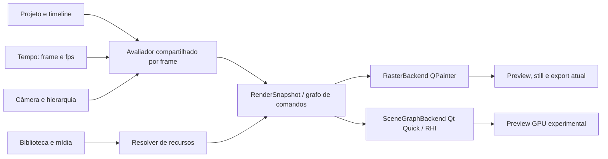

# ADR 0032 — fundação do motor gráfico 2.0

- Estado: aceita como direção arquitetural; Scene Graph segue experimental.
- Data: 26/10/2026

## Contexto

O documento do projeto já exigia medir `QPainter` e Qt Quick Scene Graph antes de decidir uma migração. O aplicativo usa `PreviewItem : QQuickPaintedItem`; seu `paint()` chama `CompositionPainter`. O render-worker também instancia `CompositionPainter` e produz `QImage` quadro a quadro antes de enviar RGBA ao FFmpeg. Isso mantém prévia, still e exportação no mesmo compositor, mas a prévia rasteriza a composição para uma imagem que o Qt Quick envia à textura. A avaliação de câmera e keyframes vem de `modules/core`; a composição resolve grupos, shots, direção de arte e mídia.

O Qt instalado é 6.8.3. Nesse release, trocar `QQuickPaintedItem` por um framebuffer acelerado não é uma opção portátil: o modo FBO desse item é ignorado em Qt 6.0–6.8. O Scene Graph tem suporte RHI a Direct3D 11, Vulkan, OpenGL e outros backends. A decisão precisa considerar qualidade, memória e exportação determinística, além do tempo por quadro. Referências: [QQuickPaintedItem 6.8](https://doc.qt.io/qt-6.8/qquickpainteditem.html), [Scene Graph 6.8](https://doc.qt.io/qt-6.8/qtquick-visualcanvas-scenegraph.html) e [QQuickRenderControl 6.8](https://doc.qt.io/qt-6.8/qquickrendercontrol.html).

## Diagnóstico atual

- `modules/core/src/project.cpp` avalia keyframes de objetos e câmera por índice de quadro; grupos e os IDs estáveis pertencem ao documento.
- `modules/composition/src/painter.cpp` calcula transformações hierárquicas e desenha fundos, shapes, texto/legendas, imagens, SVG, nativos e quadros de vídeo. Transições são compostas como camadas; o código é usado pela prévia e pelo worker.
- `modules/composition/src/native_painter*.cpp` implementa as ilustrações nativas como peças do mesmo passe QPainter. O catálogo não deve criar renderizadores paralelos por asset.
- `apps/desktop/preview_item.cpp` usa `QQuickPaintedItem`, transforma coordenadas de entrada e desenha a seleção como overlay da interface.
- `apps/render-worker/main.cpp` fixa o tempo no índice de quadro, compõe com `CompositionPainter`, envia RGBA ao FFmpeg e deixa áudio/mixagem no worker. A renderização não depende do relógio de parede.
- `modules/composition` publica `RenderSnapshot` por quadro. O QPainter e o protótipo GPU usam os mesmos estados resolvidos para câmera, grupos, keyframes, visibilidade, opacidade, direção de arte e shots.

## Medição comparativa

Executado em 26/10/2026 no Windows, Qt 6.8.3, AMD Radeon RX 7600 / driver 32.0.32015.7029 e AMD Ryzen 5 4600G. Cada perfil renderizou 60 quadros de um único projeto sintético com 120 formas arredondadas agrupadas, keyframes de grupo/objeto e movimento de câmera; há três repetições aquecidas por resolução. CPU é `CompositionPainter` para `QImage`; GPU é um protótipo `QQuickItem`/`QSGGeometryNode` em Direct3D 11, com `swapInterval=0` solicitado antes da criação dos recursos. Tempos incluem a avaliação/preparação das geometrias em cada backend, sem limitar o Scene Graph à taxa de atualização do monitor.

Esta tabela é a medição exploratória da etapa 1. O comparador de PSNR daquele protótipo não normalizava todos os formatos de canal das `QImage`; portanto, os valores de PSNR abaixo são apenas históricos e foram substituídos pelas métricas normalizadas de cor/forma/borda documentadas na etapa 3.

| Canvas | QPainter CPU ms/quadro | Scene Graph ms/quadro | PSNR CPU × protótipo | RSS do processo CPU → Scene Graph |
| --- | ---: | ---: | ---: | ---: |
| 1280×720 | 25,71 | 7,19 | 24,09 dB | 25,9 → 60,8 MiB |
| 1920×1080 | 36,30 | 6,27 | 24,13 dB | 30,3 → 73,9 MiB |
| 1080×1920 | 36,60 | 5,99 | 24,13 dB | 30,3 → 74,0 MiB |

O tempo por quadro do Scene Graph foi 72% menor em 720p, 83% menor em Full HD e 84% menor em retrato neste conjunto limitado. O RSS do processo ficou 2,3–2,4× maior no Scene Graph; esse número inclui a imagem CPU de referência ainda residente e não mede a VRAM dedicada do driver. A estimativa separada soma apenas geometria vetorial e um framebuffer RGBA, não é uma medição da memória total da GPU. A captura do protótipo tem diferença visual perceptível: 24 dB serve somente como guarda de regressão grosseira deste experimento e não atinge a consistência observada no pipeline atual (44,09 dB no smoke de preview/export). O benchmark não cobre texto, fontes, imagens, SVG, nativos, vídeo, efeitos, transições nem a exportação fora da tela; não prevê o desempenho de um motor completo. Os três tempos CPU tiveram dispersão considerável entre repetições; os valores da tabela são medianas, e o relatório conserva cada tentativa.

Os arquivos completos, PNGs e métricas estão em `artifacts/renderer-benchmark-20261026-032146512/` (fora do Git). O procedimento reproduzível é `scripts/benchmark-renderers.ps1 -Frames 60 -Nodes 120 -Repeats 3`.

## Decisão

1. Manter o projeto existente como fonte canônica. Tempo é sempre `{frame, fps}`; não usar timers de animação da interface como fonte para o render final.
2. Evoluir para um avaliador compartilhado que gera um `RenderSnapshot` imutável por quadro: transformações hierárquicas, opacidade/visibilidade, câmera, shot, direção de arte, ordem, bounds e referências a recursos resolvidos.
3. Definir um contrato de comandos/grupos de renderização derivado desse snapshot. Formas vetoriais, assets nativos e premium, tipografia, efeitos, profundidade 2.5D e mídia real são operações do mesmo grafo e compartilham tempo, coordenadas, câmera e transformações.
4. Ter adaptadores de backend, não motores por categoria: `RasterBackend` mantém QPainter e garante exportação/compatibilidade; `SceneGraphBackend` traduz o mesmo snapshot para nós/materials RHI na prévia; uma futura exportação GPU só é aceita quando sua saída fora de tela passar os mesmos testes determinísticos e de paridade.
5. Centralizar tipografia/fontes, geometria vetorial, texturas e decode de mídia em serviços/cache com chaves por revisão e orçamentos explícitos. Nativos e premium descrevem parâmetros/peças reutilizáveis; não implementam loops de composição isolados.
6. Manter seleção, alças e overlays de inspeção somente na UI. Eles não entram no snapshot exportado.
7. Não alterar schemas JSON, receitas, sincronização de voz ou projetos existentes nesta etapa. Nenhum asset premium é incluído por este protótipo.

## Primeira melhoria entregue

`RenderSnapshot` agora é construído para um quadro e possui cópias próprias do tempo/FPS/canvas, câmera resolvida, shots/transição, nós em ordem de camada, hierarquia, bounds, keyframes avaliados, opacidade/visibilidade, direção de arte e referências de mídia. O `CompositionPainter` consome os estados resolvidos e conserva a sequência de operações QPainter para manter a rasterização existente. O snapshot não mantém ponteiros para o `Project` editável e expõe acesso constante ao estado publicado. A representação define o contrato para um consumidor Scene Graph futuro; nenhum backend GPU foi ligado ao editor.

As imagens de referência cobrem o projeto demo, um quadro misto com PNG/SVG/vídeo, nativos e palavras de legenda, e uma transição dissolve. O comparador normaliza os formatos de canal antes do cálculo: os três resultados tiveram PSNR de 99 dB. Testes também verificam hierarquia, opacidade herdada, limites, câmera, referências de mídia, shots e quadro de saída da transição. O catálogo tem 72 nativos. Não houve mudança de capacidade JSON: receitas v1/v2/v3, schemas e guia da IA permanecem iguais.

As rodadas acima são registros históricos da extração do snapshot. A inspeção posterior identificou que a comparação visual antiga dependia de formato de canal não normalizado e de cor de vértice não premultiplicada; por isso, aqueles ~24 dB não devem ser comparados diretamente com o protocolo da etapa 3. O protótipo segue isolado e não autoriza adoção no editor.

O protótipo em `apps/scenegraph-prototype/` consome `RenderSnapshot::primary()`; não reavalia câmera, keyframes, hierarquia, opacidade herdada ou shots. Ele converte os nós Shape em uma malha QSG compartilhada, mantendo `drawOrder`. O material usa cores RGBA premultiplicadas, blending explícito e uma franja alfa de um pixel para antialias. Uma suíte sintética exercita retângulo, retângulo arredondado, elipse, contorno retangular, polilinha e caminho convexo; gera PNGs de referência QPainter por classe e imagens de diferença amplificadas. O item tem clipping pelo limite do canvas.

Essas primitivas são contratos internos do renderizador; receitas JSON ainda não escolhem o tipo de forma e o catálogo nativo não mudou. O Scene Graph continua experimental e não está conectado ao editor nem à exportação. `QSGVertexColorMaterial` não produziu geometria útil no backend software do Qt 6.8; o relatório marca esse backend como incompatível. Texto/tipografia, assets nativos, imagens, SVG, vídeo, fundo radial de direção de arte e composição de shots/transições continuam explicitamente não suportados.

O benchmark executável separa tempo total QPainter, construção do snapshot, preparação da malha, submissão/espera do `frameSwapped` e captura da janela. Mede RAM residente do processo e bytes reais da malha do último quadro; a VRAM dedicada não é medida. `frameSwapped` não é uma medição isolada de execução GPU. `scripts/benchmark-renderers.ps1` padrão cobre 20, 120 e 200 elementos, grupos aninhados, câmera animada, opacidade e objetos parcialmente fora do canvas, com três repetições por resolução; os resultados e diferenças ficam em `artifacts/renderer-benchmark-*`.

## Etapa 3 — primitivas vetoriais no Scene Graph

O Scene Graph agora consome somente `RenderSnapshot::primary()`: não reavalia keyframes, hierarquia, câmera, opacidade herdada, visibilidade, ordenação ou estado de shot. O snapshot fornece as transformações resolvidas; seus Shapes são traduzidos em malha de triângulos QSG. A prévia principal e a exportação continuam no `CompositionPainter`/QPainter.

O protótipo oferece retângulos, retângulos arredondados, elipses, contornos retangulares, linhas e caminhos convexos preenchidos ou traçados. O passe aplica transformação de grupo e câmera, opacidade, ordem do snapshot, clipping ao item e franja alfa de um pixel. A cor dos vértices é premultiplicada antes do blending. Os lotes são divididos antes de 60.000 vértices: a primeira matriz completa revelou que o caminho D3D11 do Qt descartava triângulos ao ultrapassar seu limite de índices de 16 bits numa única geometria (200 formas). A divisão em lotes preserva a ordem de desenho e resolveu a perda.

O comparador normaliza as imagens para ARGB32. PSNR fica como indicador geral e diagnóstico; os bloqueios de regressão também medem IoU de primeiro plano, F1 de bordas com tolerância de um pixel e MAE de cor. Para cenas preenchidas, o critério é IoU ≥ 0,94, edge F1 ≥ 0,95 e MAE ≤ 3. Para contornos e linhas de 3 px, IoU ≥ 0,74 é permitido devido à cobertura subpixel distinta entre rasterizadores; o critério continua exigindo edge F1 ≥ 0,95 e MAE ≤ 3. Os limites vêm acompanhados por PNGs dourados de QPainter e imagens de diferença amplificadas; defeitos como geometria ausente, bordas deslocadas acima de 1 px ou erro médio de cor acima de 3 falham independentemente do PSNR.

Benchmark completo executado em 26/10/2026 no Windows, Qt 6.8.3, Direct3D11. Cada cenário renderizou 60 quadros em três execuções. A cena tem grupos aninhados, câmera e transformações animadas, opacidade e elementos parcialmente fora do canvas. Os tempos estão em ms/quadro, exceto captura (ms por imagem final); RAM é o working set do processo medido durante o cenário. A coluna de espera inclui submissão e `frameSwapped`, não representa tempo puro de GPU.

| Canvas | Formas | QPainter | Snapshot | Preparação Scene Graph | Submissão/espera | Captura | RAM CPU | RAM processo Scene Graph | Geometria |
| --- | ---: | ---: | ---: | ---: | ---: | ---: | ---: | ---: | ---: |
| 1280×720 | 20 | 4,79 | 0,14 | 0,38 | 5,50 | 3,40 | 25,3 MiB | 63,1 MiB | 110 KiB |
| 1280×720 | 120 | 7,04 | 0,56 | 1,75 | 5,74 | 3,96 | 26,0 MiB | 74,0 MiB | 660 KiB |
| 1280×720 | 200 | 8,83 | 0,90 | 2,76 | 6,00 | 3,72 | 26,3 MiB | 73,2 MiB | 1.097 KiB |
| 1920×1080 | 20 | 9,11 | 0,14 | 0,39 | 6,09 | 6,33 | 29,7 MiB | 76,2 MiB | 110 KiB |
| 1920×1080 | 120 | 13,02 | 0,56 | 1,74 | 6,07 | 6,62 | 30,4 MiB | 87,1 MiB | 660 KiB |
| 1920×1080 | 200 | 13,53 | 0,95 | 2,75 | 5,82 | 6,66 | 30,8 MiB | 86,1 MiB | 1.097 KiB |
| 1080×1920 | 20 | 9,30 | 0,15 | 0,39 | 6,03 | 6,50 | 29,7 MiB | 76,4 MiB | 110 KiB |
| 1080×1920 | 120 | 13,84 | 0,59 | 1,84 | 5,90 | 6,60 | 30,4 MiB | 87,4 MiB | 660 KiB |
| 1080×1920 | 200 | 15,55 | 0,95 | 2,81 | 6,09 | 6,50 | 30,8 MiB | 86,5 MiB | 1.097 KiB |

A matriz não indica que o Scene Graph seja universalmente mais rápido: a preparação somada à submissão/espera consome cerca de 5,9–6,1 ms/quadro neste protótipo, e a captura acrescenta 3,4–6,7 ms por imagem. A RAM residente do processo Scene Graph fica 37–57 MiB acima da referência CPU; inclui Qt Quick e a imagem CPU mantida para comparação. VRAM dedicada não foi mensurada com confiabilidade. O desvio-padrão do QPainter variou de 0,23 a 2,42 ms/quadro; preparação do Scene Graph ficou entre 0,01 e 0,07 ms/quadro. O tempo de espera não isola execução GPU.

Na suíte mista de 120 formas (20 de cada classe) em 1280×720: PSNR 27,85 dB, IoU 0,948, edge F1 0,999 e MAE 1,96. As seis classes passaram as imagens de referência. Resumo por classe em 1280×720 / 20 formas:

| Primitiva | PSNR | IoU | Edge F1 | MAE |
| --- | ---: | ---: | ---: | ---: |
| Retângulo arredondado | 31,68 dB | 0,987 | 1,000 | 0,93 |
| Retângulo | 31,50 dB | 0,987 | 1,000 | 0,96 |
| Elipse | 32,74 dB | 0,987 | 1,000 | 0,74 |
| Contorno retangular | 30,13 dB | 0,775 | 1,000 | 1,17 |
| Linha | 32,13 dB | 0,769 | 0,998 | 0,75 |
| Caminho convexo | 32,45 dB | 0,985 | 1,000 | 0,76 |

IoU menor em linhas/contornos vem de diferenças na cobertura de traços finos de 3 px, não de perda do percurso; edge F1 e MAE confirmam proximidade das bordas e das cores. O relatório completo, PNGs dourados e diferenças está em `artifacts/renderer-benchmark-20261026-044152515/`; inclui dispersão por execução e comparação nos três canvases. O probe identificou que `QSGVertexColorMaterial` não entrega geometria útil ao backend software Qt 6.8, então esse backend está explicitamente não suportado pelo protótipo.

## Plano incremental de migração

| Corte | Trabalho | Critério de saída |
| --- | --- | --- |
| 0 — Instrumentação (feito parcialmente) | Benchmark reproduzível, teste de cache SVG, fotografia de referência e limites de memória. | Cenários de canvas e relatórios repetíveis; paridade atual preview/export protegida por smoke. |
| 1 — Avaliação compartilhada (implementado nesta etapa) | Extrair hierarquia, estado resolvido, câmera, ordem e metadados de shots para `RenderSnapshot`; QPainter consome estados resolvidos sem alterar pixels/schema. | Imagens de referência idênticas; a mesma `CompositionPainter` atende prévia, still e worker. |
| 2 — Primitivas vetoriais RHI (parcial, protótipo isolado) | QSG desenha retângulos, retângulos arredondados, elipses, contornos, linhas e caminhos convexos a partir do `RenderSnapshot`; aplica transformações, opacidade, ordem e clip do canvas. | O material não funciona no backend software; primitiva de curva Bézier, paths côncavos, clipping arbitrário e Scene Graph no editor continuam pendentes. Benchmarks não demonstram ganho geral nem medem VRAM. |
| 3 — Texto e assets nativos | Resolver fonte, métricas, layout e cache de glyphs/atlas com fallback; converter nativos em componentes parametrizados sobre primitivas comuns. | Métricas tipográficas estáveis, fontes externas, 72 nativos e compatibilidade com receitas existentes. |
| 4 — Imagens, SVG e efeitos | Texturas versionadas, filtros e efeitos como passes do mesmo grafo; cache LRU com limites por bytes. | Limites de memória e comparação de cor/alpha; sem desvio de direção de arte. |
| 5 — 2.5D e vídeo | Planos com profundidade e câmera compartilhada; serviço de decode com timestamp/seek, frame cache e fallback CPU. | Preview, still e MP4 comparados em saltos, trim, speed, shots e áudio embutido. |
| 6 — Exportação RHI opcional | Avaliar `QQuickRenderControl`/target RHI para batches, sob controle de quadro e dispositivo. | Exatidão temporal, cor, fontes e estabilidade do worker validadas antes de adoção. |

Cada etapa mantém o rasterizador funcional. Só considerar troca ou backend selecionável após paridade visual definida por conteúdo, memória aceitável no hardware mínimo, tempo de export e fallback reproduzíveis. O benchmark inicial não aprova uma substituição.

## Verificação desta decisão

- `scripts/build.ps1 -Test`: 5/5 testes passaram, incluindo o novo teste de snapshot e regressão visual.
- `scripts/smoke.ps1`: passou; preview/export 44,09 dB em 1280×720.
- `scripts/smoke-workspace.ps1`: passou; projetos locais, catálogo completo e 72 recursos nativos.
- `scripts/smoke-production.ps1`: passou com Microsoft Daniel; inclui receita, áudio, shots, beats, retrato, vídeo e comparações preview/export. Maior caso: 2700 quadros, 18 shots e 20 Visual Beats; preview/export 42,50 dB.
- `scripts/benchmark-renderers.ps1`: matriz padrão completa (20/120/200 formas × três canvases × três repetições), três suítes mistas e seis referências de classe; passou em Direct3D11. Uma falha inicial em 200 formas levou à divisão da geometria em lotes; a execução completa passou depois da correção. O backend software foi reportado como não suportado. Resultados e imagens: `artifacts/renderer-benchmark-20261026-044152515/`.
