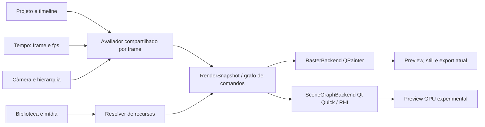

# ADR 0032 — fundação do motor gráfico 2.0

- Estado: aceita como direção arquitetural; Scene Graph segue experimental.
- Data: 26/10/2026

## Contexto

O documento do projeto já exigia medir `QPainter` e Qt Quick Scene Graph antes de decidir uma migração. O aplicativo usa `PreviewItem : QQuickPaintedItem`; seu `paint()` chama `CompositionPainter`. O render-worker também instancia `CompositionPainter` e produz `QImage` quadro a quadro antes de enviar RGBA ao FFmpeg. Isso mantém prévia, still e exportação no mesmo compositor, mas a prévia rasteriza a composição para uma imagem que o Qt Quick envia à textura. A avaliação de câmera e keyframes vem de `modules/core`; a composição resolve grupos, shots, direção de arte e mídia.

O Qt instalado é 6.8.3. Nesse release, trocar `QQuickPaintedItem` por um framebuffer acelerado não é uma opção portátil: o modo FBO desse item é ignorado em Qt 6.0–6.8. O Scene Graph tem suporte RHI a Direct3D 11, Vulkan, OpenGL e outros backends. A decisão precisa considerar qualidade, memória e exportação determinística, além do tempo por quadro. Referências: [QQuickPaintedItem 6.8](https://doc.qt.io/qt-6.8/qquickpainteditem.html), [Scene Graph 6.8](https://doc.qt.io/qt-6.8/qtquick-visualcanvas-scenegraph.html) e [QQuickRenderControl 6.8](https://doc.qt.io/qt-6.8/qquickrendercontrol.html).

## Diagnóstico atual

- `modules/core/src/project.cpp` avalia keyframes de objetos e câmera por índice de quadro; grupos e os IDs estáveis pertencem ao documento.
- `modules/composition/src/painter.cpp` calcula transformações hierárquicas e desenha fundos, shapes, texto/legendas, imagens, SVG, nativos e quadros de vídeo. Transições são compostas como camadas; o código é usado pela prévia e pelo worker.
- `modules/composition/src/native_painter*.cpp` implementa as ilustrações nativas como peças do mesmo passe QPainter. O catálogo não deve criar renderizadores paralelos por asset.
- `apps/desktop/preview_item.cpp` usa `QQuickPaintedItem`, transforma coordenadas de entrada e desenha a seleção como overlay da interface.
- `apps/render-worker/main.cpp` fixa o tempo no índice de quadro, compõe com `CompositionPainter`, envia RGBA ao FFmpeg e deixa áudio/mixagem no worker. A renderização não depende do relógio de parede.
- Vídeo e imagens têm caches limitados; ainda não há uma representação intermediária imutável do estado visual avaliado.

## Medição comparativa

Executado em 26/10/2026 no Windows, Qt 6.8.3, AMD Radeon RX 7600 / driver 32.0.32015.7029 e AMD Ryzen 5 4600G. Cada perfil renderizou 60 quadros de um único projeto sintético com 120 formas arredondadas agrupadas, keyframes de grupo/objeto e movimento de câmera; há três repetições aquecidas por resolução. CPU é `CompositionPainter` para `QImage`; GPU é um protótipo `QQuickItem`/`QSGGeometryNode` em Direct3D 11, com `swapInterval=0` solicitado antes da criação dos recursos. Tempos incluem a avaliação/preparação das geometrias em cada backend, sem limitar o Scene Graph à taxa de atualização do monitor.

| Canvas | QPainter CPU ms/quadro | Scene Graph ms/quadro | PSNR CPU × protótipo | RSS do processo CPU → Scene Graph |
| --- | ---: | ---: | ---: | ---: |
| 1280×720 | 25,71 | 7,19 | 24,09 dB | 25,9 → 60,8 MiB |
| 1920×1080 | 36,30 | 6,27 | 24,13 dB | 30,3 → 73,9 MiB |
| 1080×1920 | 36,60 | 5,99 | 24,13 dB | 30,3 → 74,0 MiB |

O tempo por quadro do Scene Graph foi 72% menor em 720p, 83% menor em Full HD e 84% menor em retrato neste conjunto limitado. O RSS do processo ficou 2,3–2,4× maior no Scene Graph; esse número inclui a imagem CPU de referência ainda residente e não mede a VRAM dedicada do driver. A estimativa separada soma apenas geometria vetorial e um framebuffer RGBA, não é uma medição da memória total da GPU. A captura do protótipo tem diferença visual perceptível: 24 dB serve somente como guarda de regressão grosseira deste experimento e não atinge a consistência observada no pipeline atual (44,09 dB no smoke de preview/export). O benchmark não cobre texto, fontes, imagens, SVG, nativos, vídeo, efeitos, transições nem a exportação fora da tela; não prevê o desempenho de um motor completo. Os três tempos CPU tiveram dispersão considerável entre repetições; os valores da tabela são medianas, e o relatório conserva cada tentativa.

Os arquivos completos, PNGs e métricas estão em `artifacts/renderer-benchmark-20261026-032146512/` (fora do Git). O procedimento reproduzível é `scripts/benchmark-renderers.ps1 -Frames 60 -Nodes 120 -Repeats 3`.

## Decisão

1. Manter o projeto existente como fonte canônica. Tempo é sempre `{frame, fps}`; não usar timers de animação da interface como fonte para o render final.
2. Evoluir para um avaliador compartilhado que gera um `RenderSnapshot` imutável por quadro: transformações hierárquicas, opacidade/visibilidade, câmera, shot, direção de arte, ordem, bounds e referências a recursos resolvidos.
3. Definir um contrato de comandos/grupos de renderização derivado desse snapshot. Formas vetoriais, assets nativos e premium, tipografia, efeitos, profundidade 2.5D e mídia real são operações do mesmo grafo e compartilham tempo, coordenadas, câmera e transformações.
4. Ter adaptadores de backend, não motores por categoria: `RasterBackend` mantém QPainter e garante exportação/compatibilidade; `SceneGraphBackend` traduz o mesmo snapshot para nós/materials RHI na prévia; uma futura exportação GPU só é aceita quando sua saída fora de tela passar os mesmos testes determinísticos e de paridade.
5. Centralizar tipografia/fontes, geometria vetorial, texturas e decode de mídia em serviços/cache com chaves por revisão e orçamentos explícitos. Nativos e premium descrevem parâmetros/peças reutilizáveis; não implementam loops de composição isolados.
6. Manter seleção, alças e overlays de inspeção somente na UI. Eles não entram no snapshot exportado.
7. Não alterar schemas JSON, receitas, sincronização de voz ou projetos existentes nesta etapa. Nenhum asset premium é incluído por este protótipo.

## Primeira melhoria entregue

`RenderSnapshot` agora é construído para um quadro e possui cópias próprias do tempo/FPS/canvas, câmera resolvida, shots/transição, nós em ordem de camada, hierarquia, bounds, keyframes avaliados, opacidade/visibilidade, direção de arte e referências de mídia. O `CompositionPainter` consome os estados resolvidos e conserva a sequência de operações QPainter para manter a rasterização existente. O snapshot não mantém ponteiros para o `Project` editável e expõe acesso constante ao estado publicado. A representação define o contrato para um consumidor Scene Graph futuro; nenhum backend GPU foi ligado ao editor.

As imagens de referência cobrem o projeto demo, um quadro misto com PNG/SVG/vídeo, nativos e palavras de legenda, e uma transição dissolve. O comparador normaliza os formatos de canal antes do cálculo: os três resultados tiveram PSNR de 99 dB. Testes também verificam hierarquia, opacidade herdada, limites, câmera, referências de mídia, shots e quadro de saída da transição. O catálogo tem 72 nativos. Não houve mudança de capacidade JSON: receitas v1/v2/v3, schemas e guia da IA permanecem iguais.

Uma nova rodada do benchmark (60 quadros, 120 formas, três repetições) mediu o caminho CPU em 28,21 ms/quadro e 26,1 MiB de RSS em 1280×720; 30,01 ms e 30,5 MiB em 1920×1080; e 43,79 ms e 30,5 MiB em 1080×1920. A rodada anterior registrou 29,39/25,9 MiB, 59,52/30,3 MiB e 53,47/30,3 MiB, respectivamente. O RSS variou apenas 0,2 MiB; os tempos tiveram dispersão considerável entre repetições, então não indicam ganho/perda estável. Relatórios completos: `artifacts/renderer-benchmark-20261026-034552038/report.json` e `artifacts/renderer-benchmark-20261026-040407049/report.json`. O teste de protótipo Scene Graph permaneceu isolado; sua comparação visual segue em torno de 24 dB e não autoriza adoção no editor.

O protótipo isolado em `apps/scenegraph-prototype/` é uma prova de mecanismo, não um backend do app: traduz formas do mesmo `Project` e avalia os keyframes/câmera com o core existente, mas usa uma tesselação simplificada. O executável gera imagem CPU, imagem Scene Graph e relatório com tempo, RSS, estimativa de geometria/framebuffer e PSNR. `scripts/benchmark-renderers.ps1` mede 120 formas em cada canvas documentado.

## Plano incremental de migração

| Corte | Trabalho | Critério de saída |
| --- | --- | --- |
| 0 — Instrumentação (feito parcialmente) | Benchmark reproduzível, teste de cache SVG, fotografia de referência e limites de memória. | Cenários de canvas e relatórios repetíveis; paridade atual preview/export protegida por smoke. |
| 1 — Avaliação compartilhada (implementado nesta etapa) | Extrair hierarquia, estado resolvido, câmera, ordem e metadados de shots para `RenderSnapshot`; QPainter consome estados resolvidos sem alterar pixels/schema. | Imagens de referência idênticas; a mesma `CompositionPainter` atende prévia, still e worker. |
| 2 — Primitivas vetoriais RHI | Implementar retângulo, elipse, path, transformações, clips e opacidade no Scene Graph; comparar com RasterBackend. | PSNR definido por classe de conteúdo, regressões em 3 canvases e testes em software/D3D11. |
| 3 — Texto e assets nativos | Resolver fonte, métricas, layout e cache de glyphs/atlas com fallback; converter nativos em componentes parametrizados sobre primitivas comuns. | Métricas tipográficas estáveis, fontes externas, 72 nativos e compatibilidade com receitas existentes. |
| 4 — Imagens, SVG e efeitos | Texturas versionadas, filtros e efeitos como passes do mesmo grafo; cache LRU com limites por bytes. | Limites de memória e comparação de cor/alpha; sem desvio de direção de arte. |
| 5 — 2.5D e vídeo | Planos com profundidade e câmera compartilhada; serviço de decode com timestamp/seek, frame cache e fallback CPU. | Preview, still e MP4 comparados em saltos, trim, speed, shots e áudio embutido. |
| 6 — Exportação RHI opcional | Avaliar `QQuickRenderControl`/target RHI para batches, sob controle de quadro e dispositivo. | Exatidão temporal, cor, fontes e estabilidade do worker validadas antes de adoção. |

Cada etapa mantém o rasterizador funcional. Só considerar troca ou backend selecionável após paridade visual definida por conteúdo, memória aceitável no hardware mínimo, tempo de export e fallback reproduzíveis. O benchmark inicial não aprova uma substituição.

## Verificação desta decisão

- `scripts/build.ps1 -Test`: 5/5 testes passaram, incluindo o novo teste de snapshot e regressão visual.
- `scripts/smoke.ps1`: passou; preview/export 44,09 dB em 1280×720.
- `scripts/smoke-workspace.ps1`: passou; projetos locais, catálogo completo e 72 recursos nativos.
- `scripts/smoke-production.ps1`: passou com Microsoft Daniel; inclui receita, áudio, shots, beats, retrato, vídeo e comparações preview/export. Maior caso: 2700 quadros, 18 shots e 20 Visual Beats; preview/export 42,50 dB.
- `scripts/benchmark-renderers.ps1 -Frames 60 -Nodes 120 -Repeats 3`: antes e depois da extração do snapshot, executado em Direct3D11 nas três resoluções; RSS CPU pós-refatoração entre 26,1 e 30,5 MiB. A variabilidade de tempo está documentada acima.
